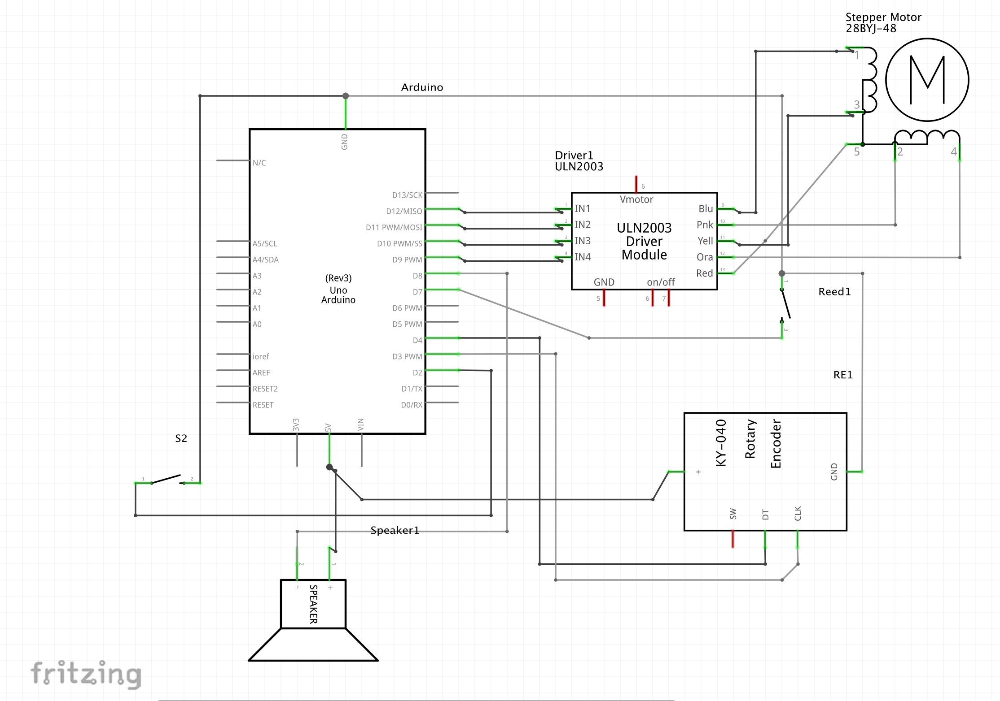

    

        <strong>Project Status:</strong> Completed
    

    

        <strong>Project Type:</strong> Personal Tool
    

    

        <strong>Created on:</strong> July 12, 2024
    

---

### Synopsis:

Custom Camera Slider I made for taking smooth shots of objects or study timelapses. 
- Knob for adjusting speed and tracking objects at different distances. 
- Top Plate rotates and has 4 heatsets for mounting phone or camera attachment.

## Fun video demo I made

<video controls width="100%">
    <source src="cam-slider-imgs/camslidervid.mov" type="video/mp4">
    Your browser does not support the video tag.
</video>

### Schematic

- https://www.youtube.com/embed/IqEN3zH5kNg?si=YWg-mg3nUWqOECCE

