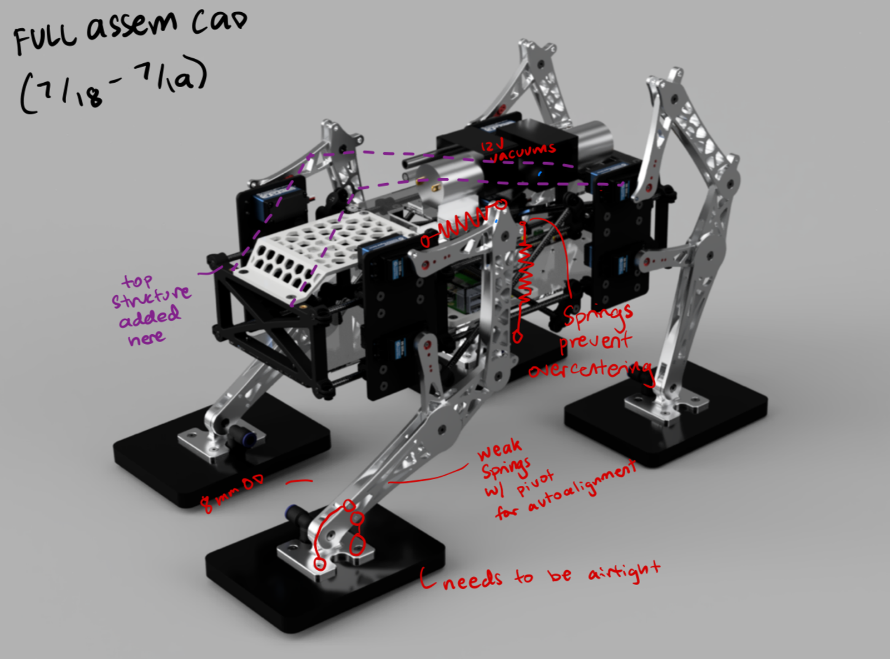
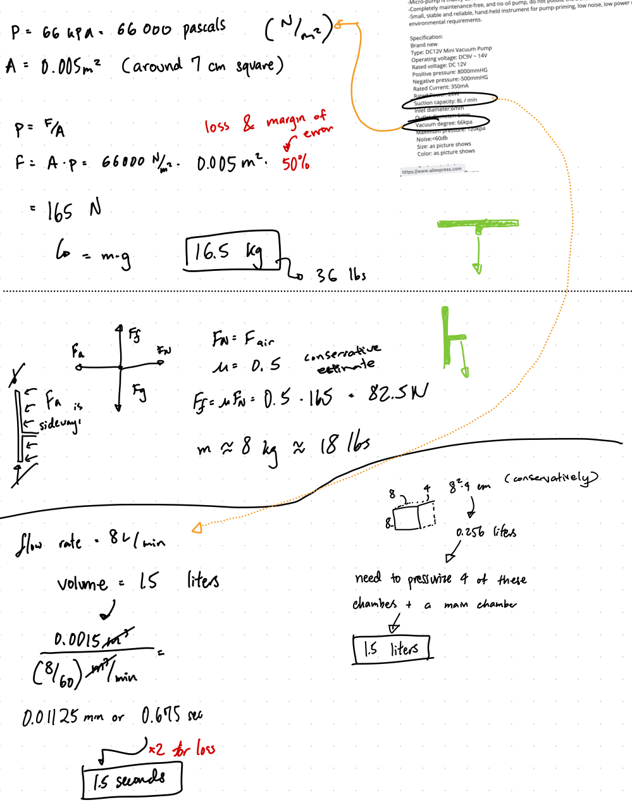

    

        <strong>Project Status:</strong> Ongoing
    

    

        <strong>Project Type:</strong> Website
    

    

        <strong>Created on:</strong> Jun 2024
    

---

### Synopsis:

A robot designed to climb vertical surfaces using suction. Paper Accepted to IRC IEEE 2024. All hardware, electronics, software completed by me. Partial funding from partner and grants.

# Working Demo 

    

        <h3>Step on vertical plane (Rotated Camera) 9/24</h3>
        <video width="80%" autoplay muted loop>
            <source src="climber-vids/dogclip2.mov" type="video/mp4">
            Your browser does not support the video tag.
        </video>
    

    

        <h3>Walking Sequence (Upside Down for Visibility) 9/24</h3>
        <video width="80%" autoplay muted loop>
             <source src="climber-vids/dogclip1.mov" type="video/mp4">
            Your browser does not support the video tag.
        </video>
    

    

        <h3>Plane Transition Motion 9/24</h3>
        <video width="80%" autoplay muted loop>
            <source src="climber-vids/dogclip3.mov" type="video/mp4">
            Your browser does not support the video tag.
        </video>
    

    

        <h3>CAD Diagram w/ Marking 7/24</h3>
        
    

# First Signs of Walking

    

        <h3> Baby Steps - First (Failed) Walk Test 8/24 </h3>
        <video width="80%" autoplay muted loop>
            <source src="climber-vids/dogclip5.mov" type="video/mp4">
            Your browser does not support the video tag.
        </video>
        <h4>Lesson: Feet can't stay planted on the ground => alternate in cycle</h4>
    

    

        <h3>Single Leg Implemented Simulation 7/24 </h3>
        <video width="80%" autoplay muted loop>
             <source src="climber-vids/dogclip6.mp4" type="video/mp4">
            Your browser does not support the video tag.
        </video>
        <h4>Sin-Step with Servo Smoothing</h4>
    

---
# Inverse Kinematics Test

    

        <video width="80%" autoplay muted loop>
            <source src="climber-vids/dogclip7.mp4" type="video/mp4">
            Your browser does not support the video tag.
        </video>
    

    

        <h3>Calculations</h3>
        
        <!--  -->
    

