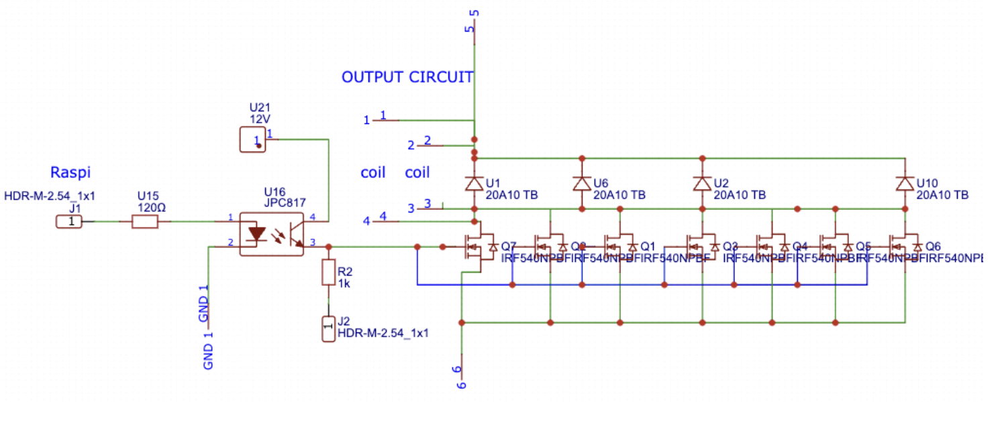
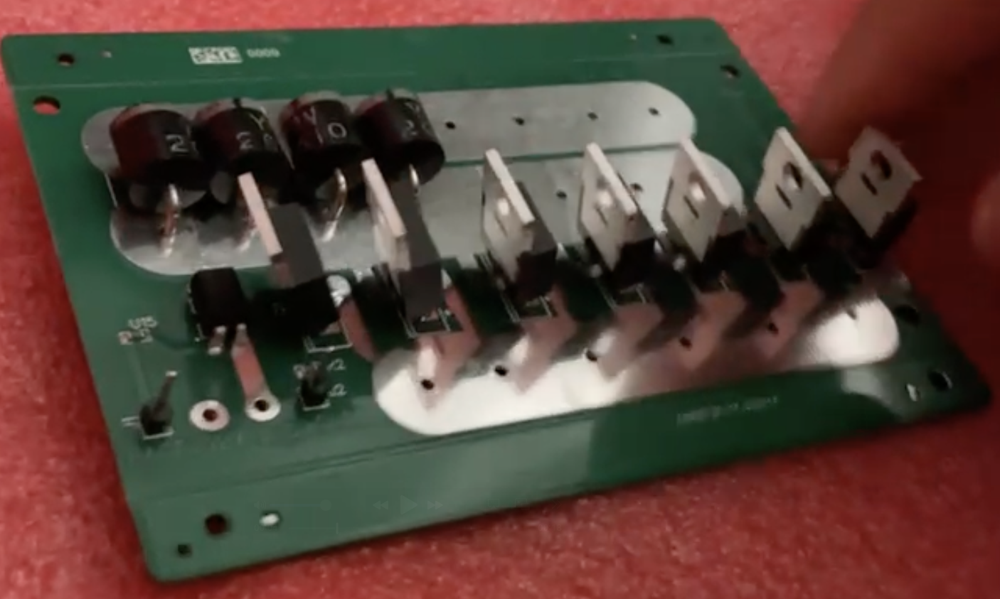

<!-- Markdown extracted from Github or Notion -->

<!-- Dividers that come from notion are redundant since the headings itself make it a divider. Video links, PDFs, and columns also have to be reformatted. -->

<!-- Top 3 columns have to be formatted in this exact div structure.  -->

    

        <strong>Project Status:</strong> Completed
    

    

        <strong>Project Type:</strong> School Project
    

    

        <strong>Created on:</strong> May 2025
    

---

## Overview

As part of Physics Mechanics/E&M lab, my lab group was tasked to create two projects that solved a social issue and applied concepts learned in the course. We decided that the best excuse to make a launcher was to call it a trash sorter. I worked on the hardware and electrical component of each project, with more specifics underneath.

---

    

        <h2> Semester 1 - Ping Pong Sorter </h2>
        
For the first semester, we decided to create a simple flywheel launcher that sorted ping pong balls as “trash”.   
        <video width="100%" muted loop controls playsinline preload="metadata">
            <source src="files/Ping-Demo.mov" type="video/mp4">
            Your browser does not support the video tag.
        </video>  
        <strong>Highlight: </strong> Using OpenCV for bin detection and incorporating drag calculations, we can accurately predict the landing position of chaotically behaving ping-pong balls.

    

    

        <h2> Semester 2 - Coil Launcher </h2>
        
For the second semester, we created a coil launcher with a cylindrical capsule to launch a greater variety of items.  
         
        <video width="100%" muted loop controls playsinline preload="metadata">
            <source src="files/Coil-Demo.mov" type="video/mp4">
            Your browser does not support the video tag.
        </video>
          
        <strong>Highlight: </strong> A digital potentiometer is used to control the buck-boost converter, enabling precise adjustment of the charging voltage for the supercapacitor bank, regulating the launch velocity.

    

## Coil Launcher Report

        

            <video width="100%" muted loop controls playsinline preload="metadata">
                <source src="files/Coil-Usage.mov" type="video/mp4">
                Your browser does not support the video tag.
            </video>
            
  While designing the launcher was insightful, I learned the most from designing the electronics, schematics, and custom PCBs, as I've never worked with high amperage circuits. 

        

        

            
            
        

<iframe class="pdf"
                src="files/Semester 2 Lab report.pdf"
            width="800" height="500">
        </iframe>

## Ping-Pong Sorter Report

        

            <video width="100%" muted loop controls playsinline preload="metadata">
                <source src="files/Ping-Turntable.mov" type="video/mp4">
                Your browser does not support the video tag.
            </video>
        

        

            <video width="100%" muted loop controls playsinline preload="metadata">
                <source src="files/Ping-Assembly.mov" type="video/mp4">
                Your browser does not support the video tag.
            </video>
        

    

<iframe class="pdf"
                src="files/Semester 1 Lab report.pdf"
            width="800" height="500">
        </iframe>

---
