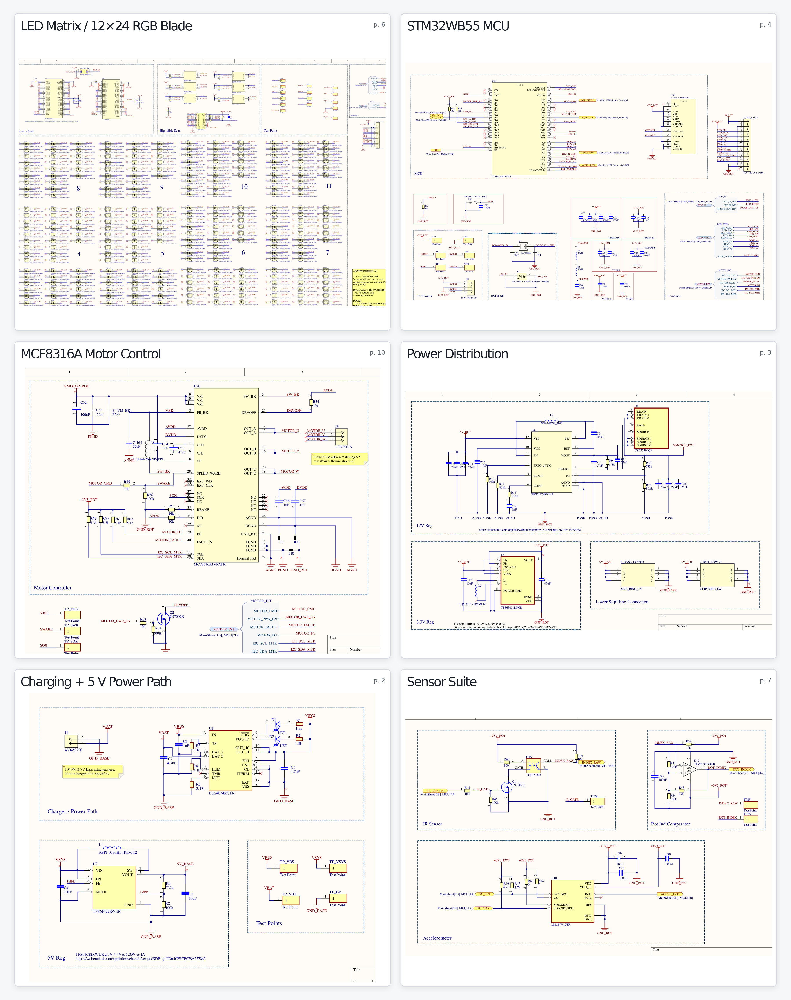
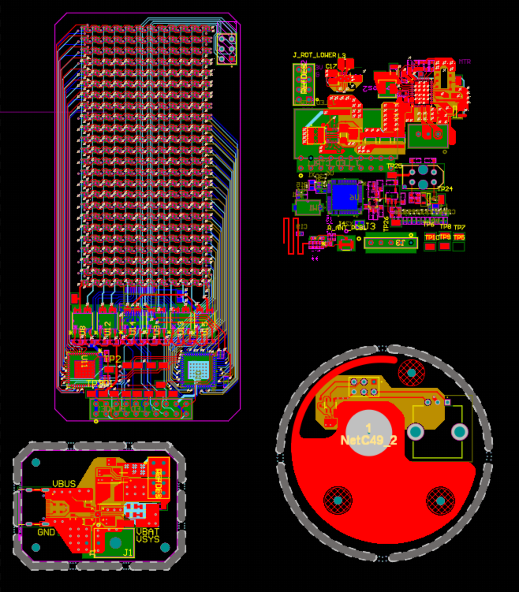

A handheld persistence-of-vision display with a rotating RGB LED array.

	

		<strong>Project Status:</strong> In development
	

	

		<strong>Project Type:</strong> Personal Interest
	

	

		<strong>Created on:</strong> 2026
	

	<figure class="schematic-sample">
		<h3 class="media-title">Schematic Samples</h3>
		
	</figure>
	<figure class="layout-sample">
		<h3 class="media-title">PCB Layout - In Progress</h3>
		
	</figure>

**Links:**

- [**GitHub**](https://github.com/hyweric/Electronic-Volumetric-Display)

## Electronics

- STM32WB55 microcontroller with Bluetooth Low Energy
- 12 × 24 array: 288 RGB pixels, controlled through 1:12 multiplexed scanning
- BLDC motor drive
- Custom 2.4 GHz PCB antenna and RF matching network
- Battery charging and power-distribution circuitry; USB-C for charging and external power

